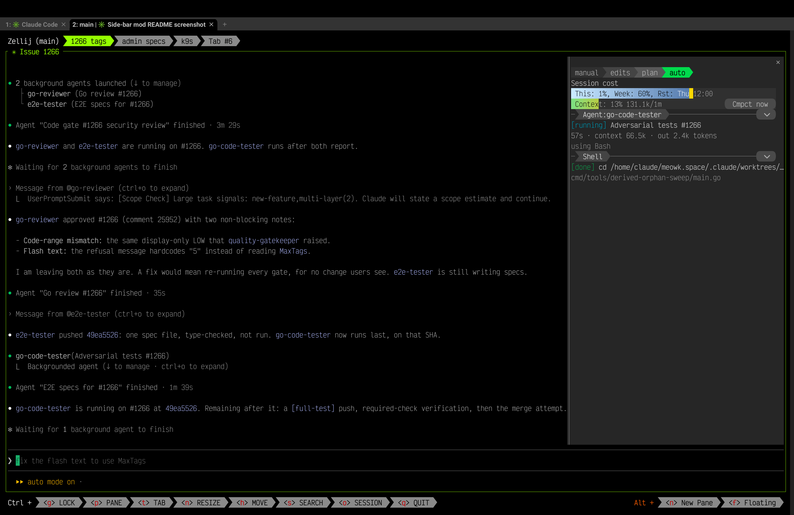

# side-monitor

A Claude Code side panel that shows:

- this session's share of the weekly usage limit;
- the context fill, with a `Cmpct now` button and automatic compaction at 85%. Pressed while a turn runs, the button reads `Cmpct next` and compacts when the turn ends; press it again to cancel;
- every running agent and main-loop shell. Collapsed, an agent shows the engine's progress summary and the call it is making now; expanded, its console: its text, each tool call as it starts, and the first lines of each result. A subagent's own shells live in its console, not as rows of their own. A shell shows its latest output line, and expanded, its full output. Press the chevron button on a section's divider to expand it to the full panel height, and press it again to collapse it. The button needs a Nerd Font.

Finished rows linger 10 s, then leave. A row also leaves when the engine no longer runs it: a background shell missing from the engine's in-flight list at a stop, a foreground shell when the main turn stops, one whose output file stays gone, and one older than Bash's 10-minute limit.

In Claude Desktop and the VS Code extension the panel draws native controls instead of terminal art: a progress bar for the context, a drawn weekly bar, plain buttons and a code view for an expanded console. Minimized to a desktop widget, it shows the context and how many tasks run.

Open the panel with `/monitor`.
