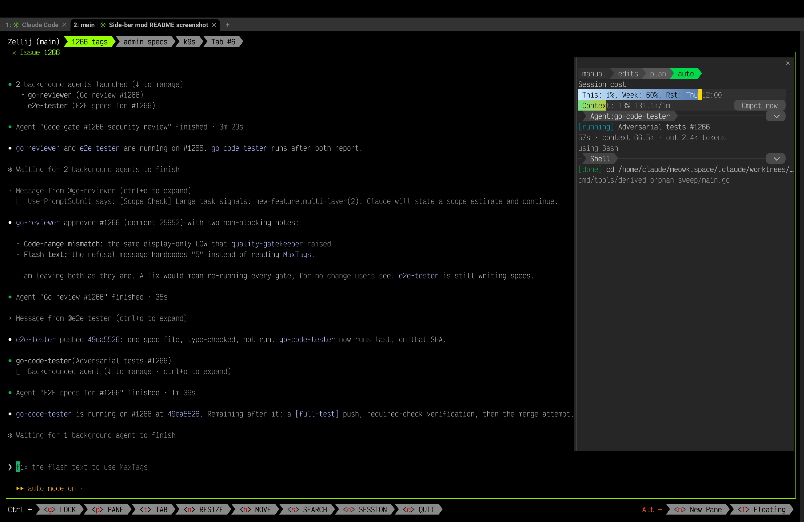

# side-monitor

A Claude Code side panel that shows:

- this session's share of the weekly usage limit;
- the context fill, with a `Cmpct now` button and automatic compaction at 85%. Pressed while a turn runs, the button reads `Cmpct next` and compacts when the turn ends; press it again to cancel;
- every running agent and shell, with its latest output line. Press the chevron button on a section's divider to expand it to the full panel height, and press it again to collapse it. The button needs a Nerd Font.

Open the panel with `/monitor`.
