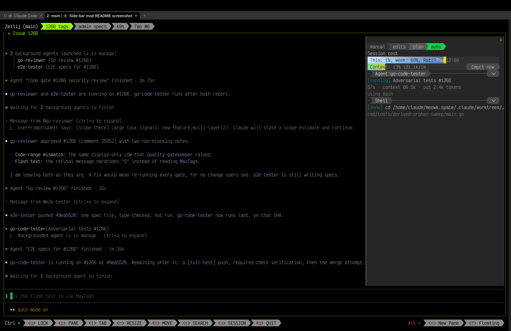

# side-monitor

A Claude Code side panel that shows:

- this session's share of the weekly usage limit;
- the context fill, with a `Cmpct now` button and automatic compaction at 85%. Pressed while a turn runs, the button reads `Cmpct next` and compacts when the turn ends; press it again to cancel;
- every running agent and shell, with its latest output line. A shell leaves the panel once it ends: by its exit line, by the engine's notification, or once no process holds its output file. The broom button at the end of the mode row rereads every row and drops the ended ones at once. Expanded, an agent shows its console: its text, each tool call, and the first lines of each result; a shell shows its full output. Press the chevron button on a section's divider to expand it to the full panel height, and press it again to collapse it. The button needs a Nerd Font.

Open the panel with `/monitor`.
